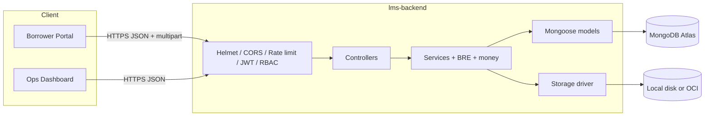
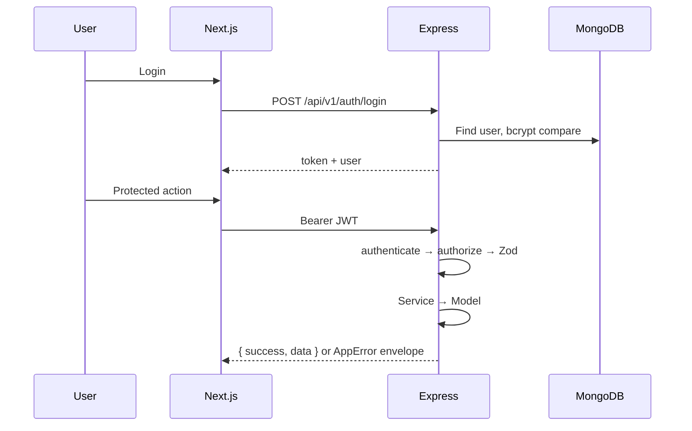
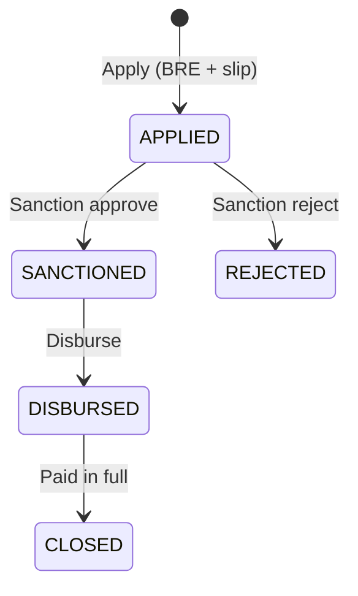
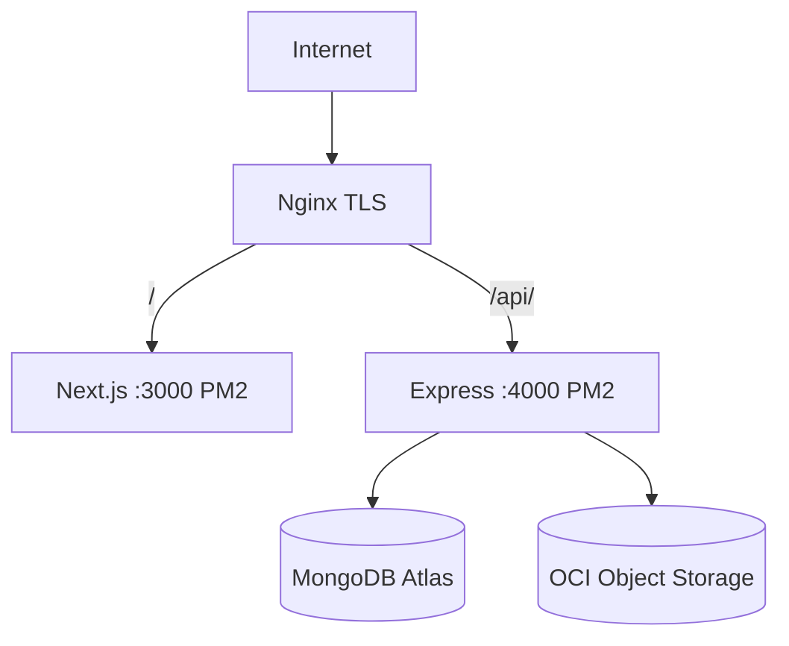

# Backend architecture

How **lms-backend** is structured: layers, auth, loan lifecycle, money, storage, and how it fits with the frontend.

Related deep-dives:

| Doc | Focus |
|-----|--------|
| [../README.md](../README.md) | Local setup + seed credentials |
| [DEPLOYMENT.md](./DEPLOYMENT.md) | Production hosting |

---

## 1. System overview

Monolithic **Express + TypeScript API** + **Next.js** UI + **MongoDB Atlas**. Two repositories, one product.

| Component | Responsibility |
|-----------|----------------|
| `lms-frontend` | Borrower portal + LoanDesk ops UI; JWT client; role route guards |
| `lms-backend` | Auth, BRE, loan lifecycle, payments, salary-slip I/O, RBAC |
| MongoDB | Users, loans, payments, salary-slip **metadata** |
| Local disk / OCI | Salary-slip **binaries** (`STORAGE_DRIVER`) |
| Nginx + PM2 | Reverse proxy / TLS / process manager on Oracle Cloud |

No microservices, message queues, or Kubernetes.



---

## 2. Request path



**Auth rate limiting** applies only to `/api/v1/auth/*` so ops traffic is not throttled with login attempts.

**API prefix:** all routes live under `/api/v1`.

---

## 3. Layered design

```text
Routes → Controllers → Services → Models
              ↓
         Validators (Zod)
              ↓
         BRE / money / storage (pure or pluggable)
```

| Layer | Rules |
|-------|--------|
| **Routes** | Mount paths; attach `authenticate`, `authorize`, upload, `validate` |
| **Controllers** | HTTP only — parse params/body, call services, return envelopes |
| **Services** | Business rules, lifecycle transitions, payment + auto-close |
| **Models** | Mongoose schemas, indexes, persistence |
| **BRE / money** | Pure functions — no Express; unit-tested |
| **Storage** | Interface + `local` / `oci` implementations |

Authoritative BRE and loan math always run on the server. Frontend previews are UX-only.

---

## 4. Source layout

```text
lms-backend/src/
├── server.ts                 # Connect DB, listen
├── app.ts                    # Express middleware stack
├── config/                   # env validation, db, loan constants
├── routes/                   # auth, borrower, loans, ops/*, health
├── controllers/
├── services/                 # auth, loan, BRE orchestration, desks, admin
├── models/                   # User, Loan, Payment, SalarySlip
├── middleware/               # auth, RBAC, validate, upload, errors, logger
├── validators/               # Zod schemas per domain
├── bre/evaluateBre.ts
├── storage/                  # localStore, ociStore, factory
├── utils/                    # AppError, money, jwt, logger, response
└── types/
```

### Route map (high level)

| Mount | Domain |
|-------|--------|
| `/health` | Liveness |
| `/auth` | Register, login, me |
| `/borrowers` | Profile, BRE check, salary slip |
| `/loans` | Preview, apply, borrower loan list/detail |
| `/salary-slips` | Authenticated download / inline view |
| `/ops/admin` | Create staff users, summary, activity |
| `/ops/sales` | Leads queue + detail |
| `/ops/sanction` | Applied queue, approve / reject |
| `/ops/disbursement` | Sanctioned queue, disburse |
| `/ops/collection` | Disbursed + closed loans, record payments |

Admin role is allowed on every ops desk. Borrowers cannot access `/ops/**`.

---

## 5. Auth and RBAC

| Concern | Decision |
|---------|----------|
| Token | JWT HS256 — claims `sub`, `role`, `email` |
| Transport | `Authorization: Bearer <token>` |
| Password | bcrypt (`BCRYPT_SALT_ROUNDS`) |
| Role model | Single `role` enum on `User` |
| Middleware | `authenticate` → 401; `authorize(...roles)` → 403 |

**Roles:** `admin` · `sales` · `sanction` · `disbursement` · `collection` · `borrower`

Frontend guards are convenience only; the API enforces access.

---

## 6. Loan lifecycle



| Transition | Actor |
|------------|--------|
| → APPLIED | Borrower |
| APPLIED → SANCTIONED / REJECTED | Sanction or admin |
| SANCTIONED → DISBURSED | Disbursement or admin |
| DISBURSED → CLOSED | System, after collection payment brings paid == total |

Invalid transitions return **409 Conflict**. Overpayment is rejected (**400**) before insert. UTR must be globally unique (**409** on duplicate).

Collection queue lists `DISBURSED` first, then `CLOSED` (status sort). Detail allows both; recording payments requires `DISBURSED`.

Details: [04-loan-lifecycle.md](./04-loan-lifecycle.md).

---

## 7. Money and BRE

### Money

- All persisted amounts are **integer paise** (₹1 = 100 paise).
- Simple-interest quote computed in `utils/money` / loan config at apply time.
- Outstanding = `totalRepaymentPaise - totalPaidPaise`.
- Auto-close when `totalPaidPaise === totalRepaymentPaise` (exact equality).

### BRE

- Pure evaluation in `bre/evaluateBre.ts`.
- Runs on profile save / apply paths; dry-run via borrower BRE check endpoint.
- Client-side checks are optional UX; server result is authoritative.

---

## 8. Salary-slip storage

| Driver | When | Binary location |
|--------|------|-----------------|
| `local` | Dev / tests (default) | `UPLOADS_DIR` on disk |
| `oci` | Production VM | Oracle Object Storage bucket |

MongoDB stores **metadata only** (`SalarySlip` — path, size, mime, borrower). Downloads always go through authenticated API routes (never public bucket URLs).

OCI reads must handle Web `ReadableStream` from the SDK when piping to Express (Node stream conversion in `ociStore`).

---

## 9. Ops desks and admin

| Desk | Reads | Writes |
|------|-------|--------|
| **Sales** | Borrowers who have not applied | — |
| **Sanction** | `APPLIED` loans | Approve / reject |
| **Disbursement** | `SANCTIONED` loans | Mark disbursed |
| **Collection** | `DISBURSED` + `CLOSED` | Record UTR payment |
| **Admin** | Summary counts + activity feed | Create staff users (not borrowers) |

List endpoints use **cursor pagination** (`cursor`, `limit`, `nextCursor`, `hasMore`) for Gmail-style ‹ › UI on the frontend.

Admin activity lines are shaped as role + actor name + event for the Overview timeline.

---

## 10. Errors and responses

Success envelope:

```json
{ "success": true, "data": { } }
```

Failures use `AppError` → consistent HTTP status + `{ success: false, error: { code, message, details? } }`.

Unhandled errors are logged and returned as 500 without leaking internals.

---

## 11. Deployment architecture



| Concern | Approach |
|---------|----------|
| Process manager | PM2 (`lms-api`, `lms-web`) |
| Secrets | `shared/.env` on VM; symlink into `current/` |
| CI/CD | GitHub Actions: test on PR; deploy on `main` |
| Health | `GET /api/v1/health` (liveness) |

Brief **502** responses can appear while PM2 reloads the API (Nginx → connection refused on `:4000`). Retry after reload. See [DEPLOYMENT.md](./DEPLOYMENT.md).

---

## 12. Design decisions (summary)

1. **Two repos** — independent deploy; shared contract via docs.  
2. **Monolith API** — matches assignment scope and small VM.  
3. **Server BRE + paise integers** — correctness over client convenience.  
4. **Pluggable storage** — local for dev, OCI for production.  
5. **JWT + role middleware** — simple RBAC without a separate auth service.  
6. **`/api/v1` versioning** — stable frontend contract.  
7. **Cursor pagination on ops queues** — scalable list UX without total counts.  
8. **Auto-close on zero balance** — collection records payment; system closes the loan.  

---

## 13. Consistency checklist for contributors

When changing behavior:

1. Update the service that owns the rule (not the controller).  
2. Keep money in paise end-to-end.  
3. Enforce role checks on the route.  
4. Align [05-api-design.md](./05-api-design.md) / frontend `ops-api` / `borrower-api` if the contract changes.  
5. Prefer tests around BRE, money, and lifecycle transitions.  
