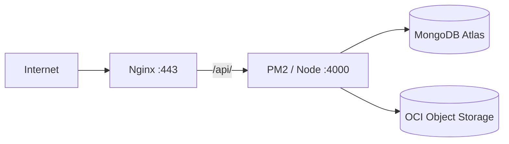

# Backend deployment

How **lms-backend** is hosted on an Oracle Cloud Ubuntu VM and shipped with GitHub Actions.

Current public stack (with frontend on the same host):

| Piece | Value |
|-------|--------|
| Host | Oracle Cloud Ubuntu VM |
| App hostname | `https://creditsea.duckdns.org` |
| API | `https://creditsea.duckdns.org/api/v1` |
| Health | `GET /api/v1/health` |
| Process | PM2 name `lms-api` → Node `:4000` |
| Proxy | Nginx (TLS) → `/api/` → `:4000` |
| Database | MongoDB Atlas |
| Files | OCI Object Storage (`STORAGE_DRIVER=oci`) |
| CI/CD | `.github/workflows/pipeline.yml` |



---

## 1. Server layout

```text
/home/ubuntu/apps/lms-backend/
├── current/                 # Active release (rsync target from Actions)
│   ├── dist/
│   ├── node_modules/        # Production deps (built on GitHub runners)
│   ├── package.json
│   ├── package-lock.json
│   └── .env → ../shared/.env
├── shared/
│   └── .env                 # Secrets — never overwritten by deploy
└── releases/                # Optional / reserved

/home/ubuntu/.oci/
├── config
└── oci_api_key.pem          # mode 600
```

| Path | Purpose |
|------|---------|
| `current/` | Code that changes every deploy |
| `shared/.env` | Secrets that must survive every deploy |

Deploy always ensures: `current/.env` → symlink to `shared/.env`.

---

## 2. One-time VM bootstrap

SSH as `ubuntu` (deploy key or personal key with access).

### 2.1 Packages and directories

```bash
mkdir -p /home/ubuntu/apps/lms-backend/{current,shared,releases}
sudo apt update
sudo apt install -y nginx rsync
# sudo npm i -g pm2   # if missing
pm2 -v && nginx -v
```

On a ~1 GB VM: keep Mongo on **Atlas**, avoid heavy Docker stacks so Node + Nginx have RAM.

### 2.2 Production `.env`

```bash
nano /home/ubuntu/apps/lms-backend/shared/.env
chmod 600 /home/ubuntu/apps/lms-backend/shared/.env
```

Example shape (replace with real values):

```env
NODE_ENV=production
PORT=4000
MONGODB_URI=<atlas-connection-string>
CORS_ORIGIN=https://creditsea.duckdns.org
TRUST_PROXY=true
JWT_SECRET=<long-random-string>
JWT_EXPIRES_IN=8h
BCRYPT_SALT_ROUNDS=12
AUTH_RATE_LIMIT_WINDOW_MS=900000
AUTH_RATE_LIMIT_MAX=20
STORAGE_DRIVER=oci
UPLOADS_DIR=./uploads
MAX_UPLOAD_BYTES=5242880
OCI_NAMESPACE=<namespace>
OCI_BUCKET=<bucket>
OCI_REGION=<region>
OCI_CONFIG_FILE=/home/ubuntu/.oci/config
OCI_PROFILE=DEFAULT
```

| Variable | Production note |
|----------|-----------------|
| `TRUST_PROXY=true` | Nginx forwards client IP / proto |
| `CORS_ORIGIN` | Exact frontend origin (scheme + host) |
| `OCI_CONFIG_FILE` | **VM** path, not a laptop path |

### 2.3 OCI credentials on the VM

From a laptop that already has working OCI API keys:

```bash
ssh -i <ssh-key> ubuntu@<VM_PUBLIC_IP> 'mkdir -p ~/.oci && chmod 700 ~/.oci'
scp -i <ssh-key> ~/.oci/oci_api_key.pem ubuntu@<VM_PUBLIC_IP>:~/.oci/oci_api_key.pem
scp -i <ssh-key> ~/.oci/config ubuntu@<VM_PUBLIC_IP>:~/.oci/config
ssh -i <ssh-key> ubuntu@<VM_PUBLIC_IP> \
  'chmod 600 ~/.oci/config ~/.oci/oci_api_key.pem && \
   sed -i "s|key_file=.*|key_file=/home/ubuntu/.oci/oci_api_key.pem|" ~/.oci/config'
```

### 2.4 Nginx (API + frontend on one host)

When both `lms-web` (:3000) and `lms-api` (:4000) run on the VM (current production):

```nginx
server {
    listen 80;
    server_name creditsea.duckdns.org <VM_PUBLIC_IP>;
    return 301 https://$host$request_uri;
}

server {
    listen 443 ssl;
    server_name creditsea.duckdns.org;

    # ssl_certificate / ssl_certificate_key managed by Certbot

    client_max_body_size 6M;

    location /api/ {
        proxy_pass http://127.0.0.1:4000;
        proxy_http_version 1.1;
        proxy_set_header Host $host;
        proxy_set_header X-Real-IP $remote_addr;
        proxy_set_header X-Forwarded-For $proxy_add_x_forwarded_for;
        proxy_set_header X-Forwarded-Proto $scheme;
    }

    location / {
        proxy_pass http://127.0.0.1:3000;
        proxy_http_version 1.1;
        proxy_set_header Host $host;
        proxy_set_header X-Real-IP $remote_addr;
        proxy_set_header X-Forwarded-For $proxy_add_x_forwarded_for;
        proxy_set_header X-Forwarded-Proto $scheme;
    }
}
```

Enable and reload:

```bash
sudo nginx -t && sudo systemctl enable --now nginx && sudo systemctl reload nginx
```

TLS: Certbot (`certbot --nginx -d creditsea.duckdns.org`). DuckDNS `ip=` must be the **VM** public IP.

### 2.5 Network / Atlas

- **OCI security list / NSG:** inbound TCP **22**, **80**, **443**. Do **not** expose `:4000` publicly.
- **Atlas Network Access:** allow the VM public IP (`x.x.x.x/32`).

### 2.6 Seed (once, against Atlas)

```bash
cd /home/ubuntu/apps/lms-backend/current   # after first successful deploy
# Or from laptop with the same production MONGODB_URI in .env
npm run seed
```

---

## 3. GitHub Actions pipeline

**File:** `.github/workflows/pipeline.yml`  
**Name:** `Pipeline`

### 3.1 When jobs run

| Event | `test` | `deploy` |
|-------|--------|----------|
| Pull request | Yes | No |
| Push to `main` | Yes | Yes (after test) |
| Manual `workflow_dispatch` | Yes | Yes (after test) |

### 3.2 Flow

```text
PR or push
   │
   ▼
[test]  lint → typecheck → test (Mongo service) → build
   │         → npm ci --omit=dev → upload artifact
   │
   ▼  (main / manual only)
[deploy] download artifact → rsync to VM → PM2 reload → health retry
```

Production `node_modules` are installed on **GitHub runners**, then rsynced. The VM does **not** run `npm ci` during deploy (important on a small instance).

### 3.3 Repository secrets

Settings → Secrets and variables → Actions:

| Secret | Purpose |
|--------|---------|
| `DEPLOY_HOST` | VM public IP |
| `DEPLOY_USER` | SSH user (`ubuntu`) |
| `DEPLOY_SSH_KEY` | Private key for deploy-only SSH |

`.env` / Atlas passwords stay **on the server** (`shared/.env`), not in GitHub.

### 3.4 Deploy SSH key (one-time)

1. Generate a key pair used only by Actions.  
2. Append the **public** key to `/home/ubuntu/.ssh/authorized_keys`.  
3. Store the **private** key as `DEPLOY_SSH_KEY`.  
4. Test: `ssh -i <deploy-private-key> ubuntu@<VM_IP> 'echo ok'`

### 3.5 Post-deploy health

Workflow polls inside the VM:

```bash
curl -sf http://127.0.0.1:4000/api/v1/health
```

(~10 attempts × 2s). Public check from your laptop:

```bash
curl -sS https://creditsea.duckdns.org/api/v1/health
```

---

## 4. Day-to-day operations

### Ship a new version

```bash
git push origin main
# or
gh workflow run Pipeline -R <owner>/lms-backend
gh run watch
```

### Useful VM commands

```bash
pm2 list
pm2 logs lms-api --lines 100 --nostream
pm2 restart lms-api
pm2 reload lms-api --update-env

curl -sS http://127.0.0.1:4000/api/v1/health
curl -sS https://creditsea.duckdns.org/api/v1/health

sudo nginx -t && sudo systemctl reload nginx
sudo tail -n 50 /var/log/nginx/error.log
```

### Change env without a code deploy

```bash
nano /home/ubuntu/apps/lms-backend/shared/.env
pm2 reload lms-api --update-env
```

---

## 5. Glossary

| Term | Meaning |
|------|---------|
| **CI (`test` job)** | Lint, typecheck, test, build — no server change on PRs |
| **Deploy job** | Rsync artifact + PM2 reload |
| **Rsync** | Sync `dist`, `node_modules`, lockfile to `current/` |
| **PM2** | Process manager; `lms-api` name; `pm2 save` + startup for reboot |
| **Nginx** | TLS + reverse proxy (`/api/` → `:4000`, `/` → `:3000`) |
| **TRUST_PROXY** | Express trusts `X-Forwarded-*` from Nginx |
| **CORS_ORIGIN** | Allowed browser origin for the API |

---

## 6. Frontend pairing

`lms-frontend` Pipeline builds Next standalone → `/home/ubuntu/apps/lms-frontend/current`, PM2 `lms-web` on **:3000**.

| Concern | Value |
|---------|--------|
| Frontend secrets | Same `DEPLOY_HOST` / `DEPLOY_USER` / `DEPLOY_SSH_KEY` pattern |
| Baked API URL | `NEXT_PUBLIC_API_BASE_URL=https://creditsea.duckdns.org/api/v1` |
| Backend CORS | `CORS_ORIGIN=https://creditsea.duckdns.org` |

---

## Related docs

- [ARCHITECTURE.md](./ARCHITECTURE.md) — system design  
- [../README.md](../README.md) — local setup + seed credentials
